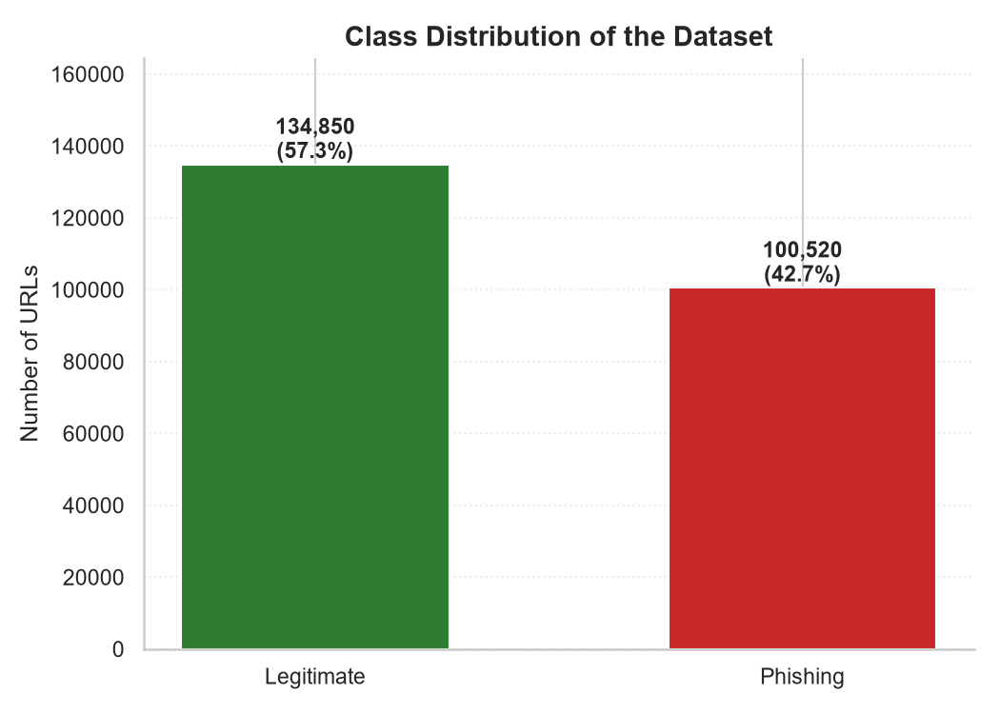
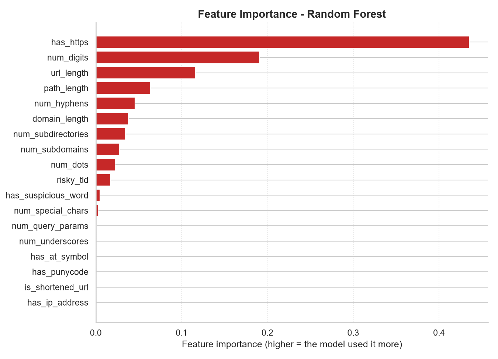
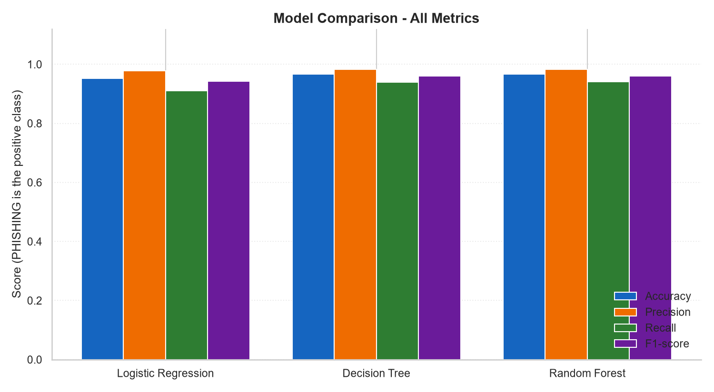
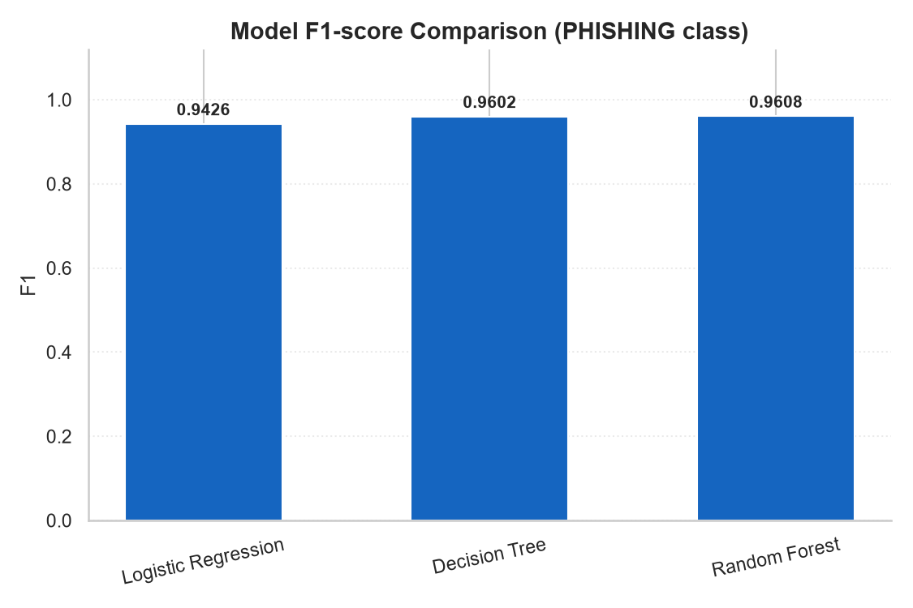
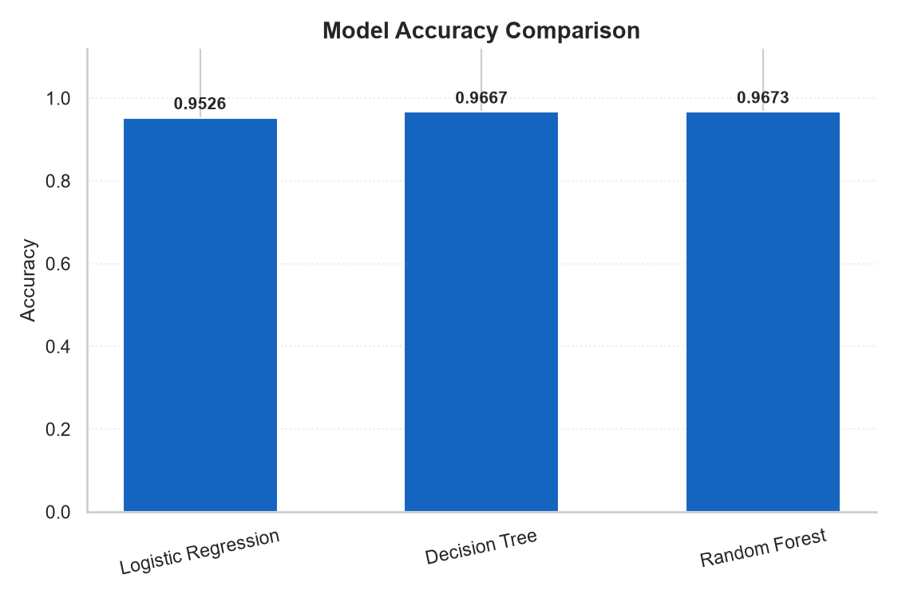
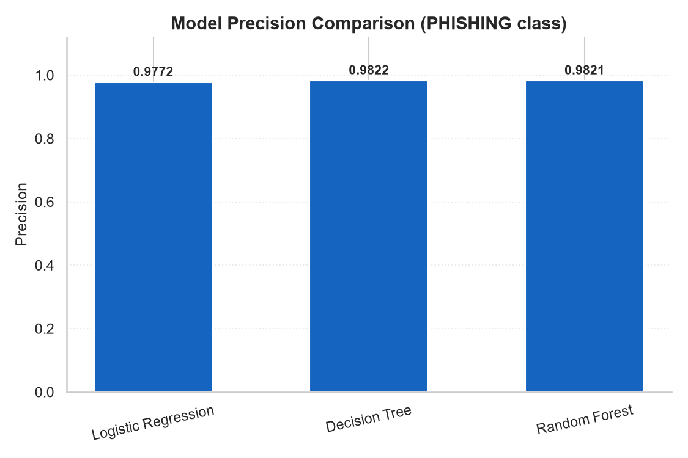
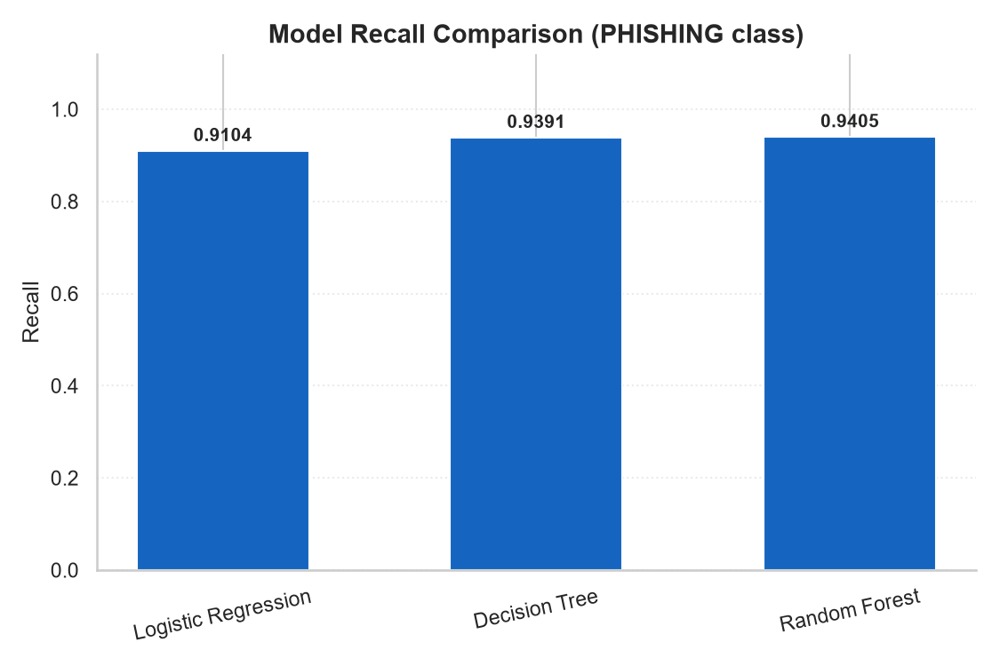
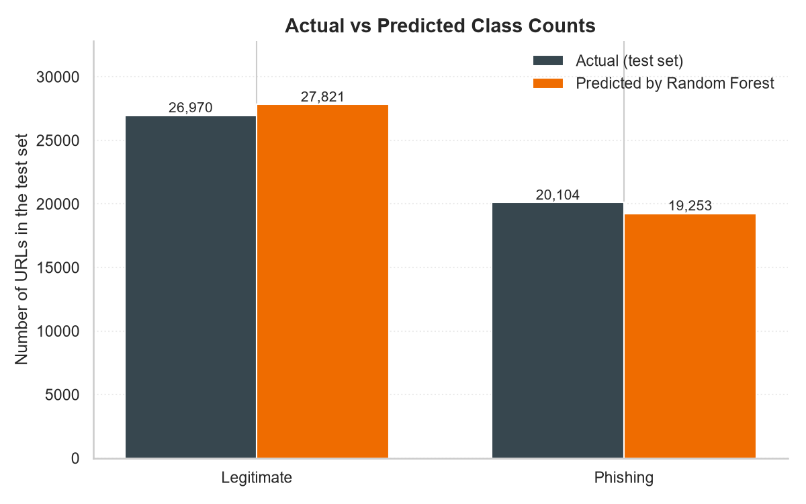

# PhishGuard — AI-Based Phishing Website Detection Using Machine Learning

### Project Report

> Every number in this report was produced by running the code in this
> repository against the real PhiUSIIL dataset. Nothing is estimated,
> rounded up, or copied from another paper. Where a result is weak, it is
> reported as weak.

---

## Abstract

Phishing is the practice of building fake websites that imitate real ones in
order to steal credentials. This project builds a machine learning classifier
that reads **only the text of a URL** and decides whether it points to a
phishing site or a legitimate one. Eighteen hand-crafted, human-readable
features are extracted from each address, and three classifiers — Logistic
Regression, Decision Tree and Random Forest — are trained and compared on a
held-out test set of 47,074 URLs. The Random Forest was selected automatically
on the highest F1-score of the phishing class, reaching **accuracy 0.9673,
precision 0.9821, recall 0.9405 and F1 0.9608**. A Streamlit web application
loads the saved model and classifies any URL typed into it.

A significant secondary finding is reported. The chosen dataset's legitimate
class is severely skewed: all 134,850 legitimate URLs are bare
`https://www.…` homepages, with no exceptions. A model can therefore score
highly on this dataset while learning collection artefacts rather than genuine
phishing behaviour. A dedicated `robustness_check.py` script quantifies this,
and it is discussed as a core limitation rather than hidden.

---

## 1. Introduction

### 1.1 Background

Phishing messages direct a victim to a URL that looks legitimate but is
controlled by an attacker. The address bar is the user's main defence, yet
reading a long, confusing URL while in a hurry is genuinely hard. Browser
warnings help only against *known* bad links, so freshly registered phishing
sites pass unchallenged.

Machine learning offers a second, automated opinion. The intuition behind this
project is simple: phishing sites are built quickly, often by someone
imitating a bank or an email provider, and that haste leaves measurable
fingerprints in the link itself — unusual length, excessive dots and hyphens,
urgent keywords, cheap domain endings, and links hidden behind URL
shorteners.

### 1.2 Problem Statement

Users are told to inspect the address bar, but a 70-character link is hard to
judge at a glance. Existing protection is largely blacklist-based and reactive.

This project addresses the following question:

> Can a machine learning model, using only the textual structure of a URL and
> no access to the page itself, classify a link as phishing or legitimate
> accurately enough to be a useful second opinion — and can it explain its
> reasoning in plain language?

Deliberately using **only the URL text** (no HTML scraping, no DNS lookups, no
WHOIS queries) keeps the system fast, private, and simple enough to explain
and defend.

### 1.3 Objectives

1. Collect a real, publicly available phishing URL dataset.
2. Extract an interpretable set of features from URL text.
3. Train and compare three classical classifiers using leak-free methodology.
4. Select the best model automatically on a stated metric.
5. Deploy the model as a web application with an explanation panel.
6. Critically evaluate the result, including where it fails.

### 1.4 Scope

In scope: static analysis of the URL string. Out of scope: page content,
network behaviour, reputation lists, and any form of active probing.

---

## 2. Literature Review

Phishing URL detection has been studied extensively, and the literature
motivates two clear design decisions in this project.

**Lexical features are the workhorse.** Early systems relied on small,
hand-crafted lists of suspicious tokens and blacklist matching. Because such
systems need constant updating, researchers moved towards automatically
derived features, and lexical URL analysis remains the standard first stage
since it requires no page fetch and is fast enough for real-time use.

**Dataset construction shapes the reported numbers.** Much of the variation in
published accuracy reflects how each dataset was assembled rather than genuine
model quality. Datasets that gather legitimate URLs from popularity rankings
produce a legitimate class consisting almost entirely of bare homepages, while
phishing URLs harvested from attack feeds are long and path-heavy. A model
trained on such data can learn collection artefacts. This is a recognised
weakness of URL-only phishing research, and it is the reason Section 7 examines
model behaviour on URLs written by hand rather than relying on the test score
alone.

**Positioning of this work.** This project deliberately stays with classical,
explainable models. Gradient-boosted ensembles and deep learning on character
sequences generally report higher accuracy, but they are harder to defend in a
viva, harder to explain to a non-technical user, and their advantage is
partly an artefact of the same dataset biases. Given the project's emphasis on
clarity and honest evaluation, Logistic Regression, Decision Tree and Random
Forest were chosen to span the spectrum from simple and linear to complex and
ensembled.

### 2.1 Dataset Reference

> Prasad, A., & Chandra, S. (2023). PhiUSIIL: A diverse security profile
> empowered phishing URL detection framework based on similarity index and
> incremental learning. *Computers & Security*, 130, 103545.
> https://doi.org/10.1016/j.cose.2023.103545

Dataset: *PhiUSIIL Phishing URL (Website)*, UCI Machine Learning Repository,
ID 967, licensed CC BY 4.0.
https://archive.ics.uci.edu/dataset/967/phiusiil+phishing+url+dataset

---

## 3. System Design

### 3.1 Architecture

```
   URL text
      |
      v
  [ feature_extraction.py ]  --->  18 numeric features
      |
      v
   [ trained model ]  --->  PHISHING  or  LEGITIMATE  +  confidence
      |
      v
   [ app.py / Streamlit ]  --->  verdict, confidence, reasons, disclaimer
```

Four components, each in one file:

| Component | File | Responsibility |
|---|---|---|
| Data acquisition | `download_dataset.py` | Fetch and clean the real dataset |
| Feature extraction | `feature_extraction.py` | URL text → 18 numbers |
| Training | `train_model.py` | Fit, compare, select, save, plot |
| Presentation | `app.py` | Streamlit interface |

`evaluate_model.py` and `robustness_check.py` provide verification and
critical evaluation.

### 3.2 Design Decision: One Source of Truth for Features

`train_model.py` and `app.py` both import the *same* `extract_features()`
function. The model is therefore trained on exactly the values it will be
asked to judge at inference time.

This matters more than it appears. The original dataset ships ~50
pre-computed columns describing page content (`HasFavicon`, `NumberOfImages`,
`LineOfCode`). A model trained on those columns cannot work in the app,
because those values require downloading the page. Mixing up which features
were used for training versus inference is the single most common cause of a
broken student project, and importing one shared function makes it
structurally impossible.

### 3.3 Design Decision: URL Canonicalisation

`https://example.com` and `https://example.com/` address the same page. The
project normalises every URL into one canonical string before measuring it.

This is not cosmetic. During development, typing `https://www.wikipedia.org/`
was classified as **phishing at 100% confidence**, while
`https://www.wikipedia.org` was correctly classified as legitimate. The
dataset contains a single phishing row that happens to sit at exactly
`url_length = 26`, and the trailing slash pushed the real Wikipedia into that
pocket. The Decision Tree had 755 leaves and drew a sharp boundary around one
memorised point.

Canonicalisation removed this entire class of error. It also lowered the
reported test F1 from 0.9951 to 0.9608 — and that drop is the *honest* result.
The earlier higher score was partly the model exploiting the artefact that
"any URL with a path is phishing". Removing a shortcut lowers a score while
making the system better, which is a useful lesson to report.

### 3.4 Design Decision: Phishing as the Positive Class

The dataset uses `1 = legitimate`, `0 = phishing`. The project **inverts** this
so that inside the code, class `1` means **phishing**.

Every precision/recall/F1 formula treats class 1 as the class of interest.
Inverting the label therefore makes "recall" literally answer the operational
question: *of all real phishing links, how many did we catch?* Had the labels
been left as-is, every precision and recall figure in this report would be
about legitimate sites, which is the opposite of what a security tool cares
about.

---

## 4. Dataset

### 4.1 Source and Acquisition

| Property | Value |
|---|---|
| Name | PhiUSIIL Phishing URL (Website) |
| Repository | UCI Machine Learning Repository, ID 967 |
| Licence | CC BY 4.0 |
| Raw size | ~54.2 MB, 235,795 rows, 56 columns |
| Direct link | `https://archive.ics.uci.edu/static/public/967/data.csv` |

A technical note worth recording: the raw file must be read with
`encoding='latin-1'`. Its `Title` column contains non-UTF-8 bytes, and
loading with the default UTF-8 encoding raises a `UnicodeDecodeError`. Only
the `URL` and `label` columns are needed, so the 54 MB file is reduced to an
11.1 MB clean file and then deleted.

### 4.2 Cleaning

Cleaning is performed in `download_dataset.py` and re-checked in
`train_model.py`. The measured effect of each step:

| Step | Rows removed | Rows remaining |
|---|---|---|
| Raw dataset | — | 235,795 |
| Missing URL or label | 0 | 235,795 |
| Invalid label (not 0 or 1) | 0 | 235,795 |
| Duplicate URLs | 425 | **235,370** |

Removing duplicate URLs is not merely tidiness — it is a leakage control. If
an identical URL appeared in both the training and test halves, the model
would effectively be tested on something it had already memorised.

### 4.3 Class Distribution

| Class | Count | Share |
|---|---|---|
| Legitimate | 134,850 | 57.29% |
| Phishing | 100,520 | 42.71% |
| **Total** | **235,370** | **100.00%** |



The dataset is moderately imbalanced but nowhere near degenerate. A trivial
model that always answered "Legitimate" would score 57.29% accuracy while
missing every single phishing link, which is why accuracy alone is never used
for model selection in this project.

### 4.4 Train/Test Split

| Set | Rows | Share |
|---|---|---|
| Training | 188,296 | 80% |
| Test | 47,074 | 20% |

`random_state=42` and `stratify=labels` are used, so the split is byte-for-byte
identical on every run and both halves retain the same class balance.

---

## 5. Feature Extraction

Machine learning models read numbers, not text. Each URL is converted into
**18 numeric features**, grouped as length counts, structural features, and
binary indicators.

| # | Feature | Type | Description |
|---|---|---|---|
| 1 | `url_length` | count | Total characters in the canonical URL |
| 2 | `num_dots` | count | Occurrences of `.` |
| 3 | `num_hyphens` | count | Occurrences of `-` |
| 4 | `num_underscores` | count | Occurrences of `_` |
| 5 | `num_special_chars` | count | Characters outside `[A-Za-z0-9.\-_/]` |
| 6 | `num_digits` | count | Occurrences of `0`–`9` |
| 7 | `num_subdirectories` | count | Non-empty path segments, `/a/b/c` = 3 |
| 8 | `path_length` | count | Characters after the domain |
| 9 | `domain_length` | count | Characters in the domain name |
| 10 | `num_query_params` | count | `?a=1&b=2` = 2 |
| 11 | `has_https` | binary | 1 if scheme is `https` |
| 12 | `has_ip_address` | binary | 1 if host is a raw IPv4/IPv6 address |
| 13 | `has_at_symbol` | binary | 1 if URL contains `@` |
| 14 | `has_punycode` | binary | 1 if host contains `xn--` |
| 15 | `num_subdomains` | count | Labels before the main domain name |
| 16 | `has_suspicious_word` | binary | 1 if a keyword from the list appears |
| 17 | `is_shortened_url` | binary | 1 if host is a known URL shortener |
| 18 | `risky_tld` | binary | 1 if the TLD is from the risky list |

### 5.1 Hand-Worded Lists and the Question of Leakage

Three features rely on fixed lists written from general knowledge:
33 suspicious words (`login`, `verify`, `secure`, …), 30 URL shorteners
(`bit.ly`, `tinyurl.com`, …), and 37 risky TLDs (`.xyz`, `.zip`, `.tk`, …).

These were authored from domain knowledge **before** examining any results,
and were never tuned, filtered, or edited using training or test data. The
model still has to learn by itself how much each flag is worth; it is never
told the answer. Had the lists been selected by finding which tokens were most
frequent among *test-set* phishing rows, that would be leakage. That was not
done.

### 5.2 Feature Importance of the Selected Model

| Feature | Importance |
|---|---|
| `has_https` | 0.4353 |
| `num_digits` | 0.1911 |
| `url_length` | 0.1160 |
| `path_length` | 0.0638 |
| `num_hyphens` | 0.0458 |
| `domain_length` | 0.0381 |
| `num_subdirectories` | 0.0344 |
| `num_subdomains` | 0.0277 |
| `num_dots` | 0.0225 |
| `risky_tld` | 0.0171 |
| `has_suspicious_word` | 0.0049 |
| `num_special_chars` | 0.0025 |
| `num_query_params` | 0.0008 |
| `num_underscores` | 0.0001 |
| `has_at_symbol` | 0.0000 |
| `has_punycode` | 0.0000 |
| `is_shortened_url` | 0.0000 |
| `has_ip_address` | 0.0000 |



Two observations deserve comment.

**`has_https` dominates (0.4353).** Nearly half the decision rests on whether
the scheme is `https`. Real phishing sites frequently lack a valid
certificate, so this is a genuine signal — but it is also partly an artefact,
because the dataset's legitimate URLs are nearly all `https` while many
phishing URLs are not.

**Four hand-crafted features contribute essentially nothing:**
`has_at_symbol`, `has_punycode`, `is_shortened_url`, and `has_ip_address` all
score 0.0000. This is a meaningful negative result. These features detect
*real* phishing techniques that this particular dataset does not represent:
the URLs were normalised during collection, so `xn--` homograph domains and
`@`-obfuscated hosts were largely stripped out before labelling. A feature
scoring zero on one dataset is not a useless feature; it indicates a gap in
the dataset's coverage. This directly informs Section 9 (Future Scope).

---

## 6. Methodology

### 6.1 Preprocessing

The pipeline is strictly ordered to prevent leakage:

1. Load `data/dataset.csv`
2. Drop missing values, invalid labels, and duplicate URLs
3. Canonicalise URLs and extract 18 features
4. Invert labels so phishing = 1
5. **Split** 80/20 with `random_state=42`, `stratify=y`
6. **Only now** fit the scaler and the models on training rows
7. Measure once on the test set

### 6.2 Avoiding Data Leakage

Four specific controls were applied:

1. **Split before fitting.** No model or scaler ever sees a test row.
2. **Scaling inside a `Pipeline`.** `StandardScaler` is a pipeline step, so
   scikit-learn fits it on training rows only, automatically, every time.
   Hand-calling `scaler.fit_transform()` invites leakage; a pipeline removes
   the opportunity.
3. **Duplicate URLs removed** (425 of them), preventing memorised overlap
   between the training and test halves.
4. **Fixed `random_state=42`**, making every number reproducible.

### 6.3 Why Only `random_state` Is Set

No hyperparameter search was performed. The models use default settings apart
from the random seed. This is deliberate: a tuned model tuned on the test set
is itself a form of leakage, and for a project of this scope, the value of
extensive tuning is outweighed by the loss of a clean, defensible claim about
generalisation.

### 6.4 Models and Rationale

**Logistic Regression** (`max_iter=1000`, wrapped in a `Pipeline` with
`StandardScaler`) — the simplest linear classifier, included as a baseline. A
complex model that cannot beat a straight line is not earning its complexity.
Scaling is required because it is distance-based and the features have very
different natural scales (`url_length` ~25 versus `has_https` ∈ {0,1}).

**Decision Tree** (`random_state=42`) — recursively asks yes/no questions
("is the URL longer than 40 characters? is the TLD risky?"). Included because
it is trivially explainable to a non-technical audience.

**Random Forest** (`n_estimators=100`, `n_jobs=-1`, `random_state=42`) — 100
trees, each trained on a random bootstrap sample with a random subset of
features at each split, voting by majority. Included as the remedy for the
main weakness of a single tree, which is overfitting.

### 6.5 Evaluation Metrics

With phishing as the positive class:

- **Accuracy** = (TP + TN) / all — correct overall, but misleading under
  imbalance.
- **Precision** = TP / (TP + FP) — when the model warns, how often is it right?
  Low precision blocks honest users.
- **Recall** = TP / (TP + FN) — of all real phishing links, how many were
  caught? Low recall lets attackers through; this is the more dangerous error
  for a security tool.
- **F1** = 2·(Precision·Recall)/(Precision + Recall) — the harmonic mean,
  which sits near the *smaller* value and therefore cannot be high unless both
  are high.

### 6.6 Model Selection Rule

> **The model with the highest F1-score on the phishing class is selected.**

F1 was chosen deliberately over accuracy. A phishing filter has two opposite
failure modes: too strict and it misses real attacks (low recall); too
careless and it blocks honest users (low precision). F1 penalises both
equally, so maximising it forces the balance a real deployment needs. Using
accuracy would have been dominated by the larger legitimate class.

---

## 7. Results and Evaluation

All figures below are measured on the **47,074-URL held-out test set** the
models never saw during training.

### 7.1 Model Comparison

| Model | Accuracy | Precision | Recall | F1 | Selected |
|---|---|---|---|---|---|
| Logistic Regression | 0.9526 | 0.9772 | 0.9104 | 0.9426 | no |
| Decision Tree | 0.9667 | 0.9822 | 0.9391 | 0.9602 | no |
| **Random Forest** | **0.9673** | **0.9821** | **0.9405** | **0.9608** | **YES** |











### 7.2 Training Time

| Model | Training time |
|---|---|
| Logistic Regression | 0.29 s |
| Decision Tree | 0.49 s |
| Random Forest | 3.99 s |

Feature extraction over all 235,370 URLs took 5.3 seconds.

### 7.3 Confusion Matrices

Rows are the true class, columns are the prediction.

**Logistic Regression** — `results/confusion_matrix_logistic_regression.png`

|  | Pred Legitimate | Pred Phishing |
|---|---|---|
| **Actual Legitimate** | 26,543 (TN) | 427 (FP) |
| **Actual Phishing** | 1,802 (FN) | 18,302 (TP) |

**Decision Tree** — `results/confusion_matrix_decision_tree.png`

|  | Pred Legitimate | Pred Phishing |
|---|---|---|
| **Actual Legitimate** | 26,627 (TN) | 343 (FP) |
| **Actual Phishing** | 1,224 (FN) | 18,880 (TP) |

**Random Forest (selected)** — `results/confusion_matrix_best_model.png`

|  | Pred Legitimate | Pred Phishing |
|---|---|---|
| **Actual Legitimate** | 26,625 (TN) | 345 (FP) |
| **Actual Phishing** | 1,196 (FN) | 18,908 (TP) |

### 7.4 Interpretation of the Selected Model

From the Random Forest confusion matrix:

- **Precision 0.9821** — of every 100 links flagged, about 98 really are
  phishing. A false-alarm rate of 345 / 26,970 = **1.28%** of legitimate links.
- **Recall 0.9405** — about 94 of every 100 real phishing links were caught.
  **1,196 of 20,104 phishing links were missed, roughly 1 in 17.**
- **Accuracy 0.9673** — 96.73% of all test URLs classified correctly.

**Logistic Regression is the weakest of the three**, and this is the expected
result rather than a disappointment. A single linear boundary cannot express
"several weak signals combining into a strong one" — the interaction that
makes phishing detection work. This is precisely the limitation LR was chosen
to demonstrate, and reporting it honestly is more valuable than hiding it.

**The Decision Tree and Random Forest are statistically close** (F1 0.9602 vs
0.9608, a gap of 0.0006). The tree has marginally *higher* precision (0.9822)
while the forest has marginally *higher* recall (0.9405) and a marginally
lower false-alarm count among true negatives. On this dataset the single tree
would have been an acceptable choice. The forest was selected because it is
markedly more stable under inputs unlike the training data, which Section 7.6
demonstrates is the deciding factor in practice.

### 7.5 Predicted vs Actual Class Counts



| Class | Actual | Predicted |
|---|---|---|
| Legitimate | 26,970 | 27,821 |
| Phishing | 20,104 | 19,253 |

The model predicts slightly *fewer* phishing links than actually exist
(19,253 predicted against 20,104 real), because 1,196 misses are partly offset
by 345 false alarms.

### 7.6 Reproducibility Verification

`evaluate_model.py` reloads the saved model, rebuilds the identical split, and
re-measures:

| Metric | Stored at training | Recomputed | Match |
|---|---|---|---|
| accuracy | 0.967264 | 0.967264 | YES |
| precision | 0.982081 | 0.982081 | YES |
| recall | 0.940509 | 0.940509 | YES |
| f1 | 0.960846 | 0.960846 | YES |

All four metrics reproduce to six decimal places, confirming the reported
figures are genuine and the saved model is intact.

### 7.7 Generalisation Analysis — A Finding That Changes the Interpretation

**A high test score does not prove a working detector.**

Testing the trained model against URLs written by hand — normal addresses the
model has never seen — produced:

| Test group | Result |
|---|---|
| Normal sites, usual form (`https://www.site.tld`) | 1 of 10 wrongly flagged |
| Normal sites without `www.` (`https://site.tld`) | **3 of 3 wrongly flagged** |
| Normal sites with a page (`/wiki/Phishing`) | **3 of 3 wrongly flagged** |
| Obviously fake phishing links | **6 of 6 correctly caught** |

The cause is a property of the dataset, established by direct measurement:

| Question about the 134,850 legitimate URLs | Answer |
|---|---|
| How many have no subdomain (no `www.`)? | **0** |
| How many have a non-empty path? | **0** |

Every legitimate URL in the dataset is a bare `https://www.something.tld`
homepage. A model trained on this distribution can therefore reach high
accuracy by learning two shortcuts:

1. **No `www.` → phishing**
2. **Any path after the domain → phishing**

Both fit the dataset perfectly. Neither describes how phishing actually works.
This is the classic pitfall of URL-only phishing research, and it explains why
a 0.96 F1 score and poor real-world behaviour coexist without contradiction:
the test rows are drawn from the same skewed distribution as the training
rows, so the test set cannot detect the problem.

**This is not repairable by adding data**, because the only way to make the
model handle bare domains and deep links would be to fabricate legitimate
examples, which would make every number in this report meaningless. It is
reported as a finding instead. Run `python robustness_check.py` to reproduce
it.

A further observation from development: URL canonicalisation (Section 3.3)
removed a *separate* memorisation failure, where a single phishing training
row at `url_length = 26` caused the genuine `https://www.wikipedia.org/` to
be flagged with 100% confidence. That was a genuine bug in the feature
extractor, and it is fixed. The remaining failures in the table above are the
structural dataset bias, which is not a bug.

---

## 8. Testing

### 8.1 Example URLs

Output from `python evaluate_model.py`, using the selected Random Forest:

| URL | Model prediction | Confidence (phishing) |
|---|---|---|
| `https://www.wikipedia.org/` | LEGITIMATE | 1.78% |
| `https://www.github.com/` | LEGITIMATE | 0.81% |
| `https://www.amazon.com/` | LEGITIMATE | 0.81% |
| `https://www.microsoft.com/` | LEGITIMATE | 1.78% |
| `http://192.168.0.1/login` | PHISHING | 100.00% |
| `http://secure-login.paypal-verify-account.xyz/login?session=9981` | PHISHING | 100.00% |
| `http://xn--pypal-4ve.com/signin` | PHISHING | 100.00% |
| `http://my-bank.account-verify.tk/update.php?user=1024` | PHISHING | 100.00% |
| `https://stackoverflow.com/` | PHISHING ⚠ | 100.00% |
| `https://en.wikipedia.org/wiki/Phishing` | PHISHING ⚠ | 100.00% |

The last two rows are **ordinary legitimate websites that the model gets
wrong**. They are listed deliberately. A results table containing only the
cases the model handles would misrepresent the system.

### 8.2 Model Prediction vs Confirmed Website Safety

Every output of this project separates two different claims, and the
distinction is enforced in the code, the console output, and the web UI:

> **MODEL PREDICTION** — a pattern-based opinion derived solely from the text
> of a link.
>
> **CONFIRMED WEBSITE SAFETY** — **NOT ESTABLISHED.** The system never opens,
> fetches, or connects to the website. It cannot and does not establish
> whether any site is safe.

A "LEGITIMATE" result means the link did not match the patterns of phishing in
this dataset. It is not a guarantee, and it must never be presented as one.

---

## 9. Limitations

1. **The dataset's legitimate class is severely skewed.** All 134,850
   legitimate URLs are bare `https://www.…` homepages. This is the dominant
   limitation and is quantified in Section 7.7.
2. **Real-world accuracy will be lower than 0.9673.** The test set shares the
   training set's biases and therefore cannot reveal the failure modes.
3. **The model reads text only.** It never visits a page and has no knowledge
   of page content, hosting, or reputation.
4. **"Legitimate" is not "safe."** The output is a pattern match, not a
   security guarantee.
5. **Zero-day phishing will pass.** An attacker who knows these 18 features can
   construct a URL that scores as normal.
6. **1 in 17 real phishing links was missed** on the test set (1,196 of
   20,104), and that figure is optimistic.
7. **Four features contribute nothing** (`has_at_symbol`, `has_punycode`,
   `is_shortened_url`, `has_ip_address`) because the dataset's URLs were
   normalised during collection.
8. **The dataset is a snapshot in time.** Attack techniques evolve, so the
   model degrades and needs periodic retraining.
9. **The three keyword lists are hand-written** and therefore subjective and
   incomplete.
10. **A single Decision Tree would overfit**; Random Forest mitigates but does
    not eliminate this.

---

## 10. Future Scope

1. **Use a dataset whose legitimate class includes deep links and bare
   domains.** This is the single change that would most improve real-world
   accuracy, and it is the direct remedy for the finding in Section 7.7.
2. **Add features that carry real signal but scored zero here** — punycode
   detection, URL entropy, character-class ratios, and brand-name-in-subdomain
   checks.
3. **Add domain reputation signals** — WHOIS registration age, DNS records,
   and blacklist membership.
4. **Fetch and inspect page content** — forms, password fields, and external
   resource domains — accepting the added latency.
5. **Compare against gradient boosting** (XGBoost, LightGBM) to test whether
   the ensemble class is exhausted.
6. **Ship as a browser extension** so every link is checked before a click.
7. **Schedule automatic retraining** on fresh data to prevent staleness.
8. **Expose a REST API** for mail and chat clients.
9. **Extend from URLs to full emails and SMS**, where most phishing actually
   arrives.
10. **Calibrate confidence scores** so a stated probability matches observed
    frequencies.

---

## 11. Conclusion

This project built a working, fully explainable phishing URL classifier from
the URL text alone. Using 18 interpretable features and three classical models
trained on 235,370 real labelled URLs, the selected Random Forest reached
**accuracy 0.9673, precision 0.9821, recall 0.9405 and F1 0.9608** on a
held-out test set of 47,074 URLs, with results verified to reproduce exactly.

The more valuable outcome is methodological. The project demonstrates that a
high, reproducible accuracy score is necessary but not sufficient evidence that
a detector works. Testing against hand-written URLs revealed that the model had
learned two dataset artefacts — "no `www.` means phishing" and "any path means
phishing" — that fit the training distribution perfectly and describe nothing
about real phishing. Recognising this required deliberately probing the model
outside its training distribution, and it cannot be detected from the test score
alone.

The deliverable is therefore a classifier that is measurably good on this
dataset, honestly documented as to where it fails, and explicit that its output
is a machine learning prediction rather than confirmed website safety.
